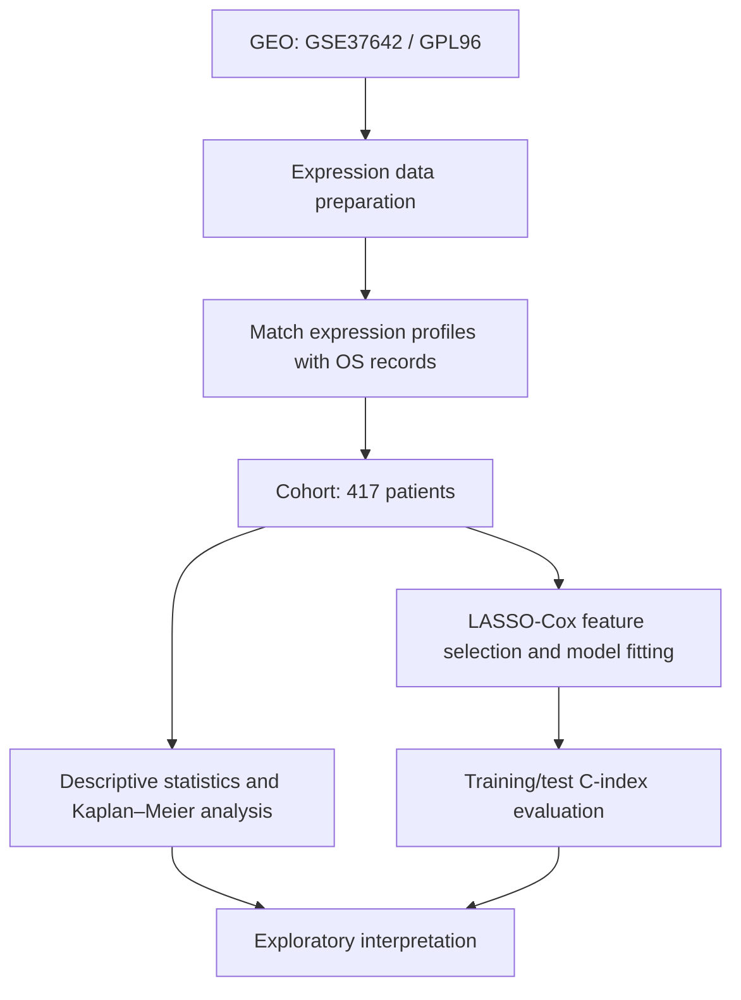

# AML Prognosis Analysis

**Exploratory overall-survival analysis in acute myeloid leukemia (AML)**  
GEO accession: **GSE37642** · Platform: **GPL96** · Analysis cohort: **417 patients**

[](https://qiaolin521.github.io/AML-Prognosis-Streamlit/)
[](https://github.com/Qiaolin521/AML-Prognosis-Streamlit/blob/main/app.py)

> This repository presents an academic and educational demonstration of AML survival analysis. The results are exploratory and must not be used for individual patient prognosis or clinical decision-making.

---

## 1. Project overview

This project uses the public Gene Expression Omnibus (GEO) dataset **GSE37642** (microarray platform **GPL96**) to explore overall survival (OS) in patients with AML. The workflow includes expression/survival-data preparation, descriptive survival analysis, Kaplan–Meier (KM) estimation, and exploratory feature selection with a LASSO-penalized Cox proportional-hazards model.

The repository includes:
- A static HTML analysis report published with GitHub Pages.
- A Streamlit dashboard source file for local execution.
- A summary of the cohort, model performance, candidate genes, methods, and limitations.

## 2. Cohort summary

| Measure | Result |
|---|---:|
| Patients with usable OS information | **417** |
| Observed deaths (events) | **308** |
| Censored observations | **109** |
| Kaplan–Meier median OS | **329 days** |

In this analysis, death is treated as the event and patients without an observed death during follow-up are treated as censored observations.

## 3. Analysis workflow



## 4. Overall-survival analysis

The cohort contains 308 observed death events and 109 censored observations. The Kaplan–Meier estimate of median overall survival is **329 days**.

The online report includes the cohort summary and survival-analysis section. The original figure files can be added to the repository under `assets/` when available; see [Optional figure files](#8-optional-result-files).

## 5. Exploratory LASSO-Cox model

Model discrimination was summarized using the concordance index (C-index).

| Data split | C-index |
|---|---:|
| Training set | **0.6776** |
| Test set | **0.5860** |

The lower test-set C-index indicates limited discrimination in the current test set and a gap between training and test performance. These results should be interpreted as exploratory internal evaluation, not evidence of clinical validity.

### Candidate prognostic-gene coefficients

The following five representative coefficients are included in the current dashboard source. They are not the complete selected-gene list.

| Gene | Coefficient |
|---|---:|
| DDIT4 | 0.174844 |
| CST3 | -0.109641 |
| HOPX | 0.089646 |
| F2RL1 | 0.088470 |
| ST18 | -0.074321 |

Positive and negative coefficients indicate the direction of association with the model-estimated risk score in this fitted model. They do not establish causal effects.

## 6. Methods

- **Data source:** GEO GSE37642, GPL96.
- **Endpoint:** Overall survival (OS).
- **Censoring:** Patients without an observed death during follow-up are treated as censored.
- **Survival description:** Kaplan–Meier method.
- **Feature selection/model:** LASSO-penalized Cox proportional-hazards regression.
- **Model evaluation:** C-index in the training and held-out test sets.
- **Dashboard implementation:** Python and Streamlit.

The repository's `app.py` contains the dashboard implementation and displays the verified cohort/model summary, representative gene coefficients, methods, and limitations. It is not a substitute for the full model-training analysis script.

## 7. Repository contents

| File | Description |
|---|---|
| `README.md` | Project overview and summarized results |
| `app.py` | Streamlit dashboard source code |
| `index.html` | Static HTML analysis report used by GitHub Pages |
| `requirements.txt` | Python package requirements |

### View the project

- **Online HTML report:** [Open AML Prognosis Analysis](https://qiaolin521.github.io/AML-Prognosis-Streamlit/)
- **Streamlit source code:** [View app.py](https://github.com/Qiaolin521/AML-Prognosis-Streamlit/blob/main/app.py)
- **Repository:** [Qiaolin521/AML-Prognosis-Streamlit](https://github.com/Qiaolin521/AML-Prognosis-Streamlit)

### Run the dashboard locally

```bash
pip install -r requirements.txt
streamlit run app.py
```

## 8. Optional result files

To display the original analysis figures in the Streamlit dashboard, create an `assets/` folder and add the corresponding PNG files:

- `AML_overall_KM_curve.png`
- `AML_test_risk_group_KM.png`
- `AML_survival_outcome_distribution.png`
- `AML_survival_time_distribution.png`
- `AML_LASSO_Cox_Cindex_comparison.png`
- `AML_LASSO_Cox_selected_gene_coefficients.png`
- `AML_top20_variable_genes.png`

To display the complete selected-gene table, place `AML_LASSO_Cox_selected_genes_threshold_1e-5.csv` in the `data/` folder. The CSV should contain the columns `gene`, `coefficient`, and `abs_coefficient`.

Only aggregate results and figures should be published. Do not upload raw expression matrices or patient-level clinical data to this public repository.

## 9. Limitations and responsible use

1. This analysis is based on a single public dataset and may be affected by cohort composition, platform characteristics, and the availability of clinical variables.
2. The current test-set C-index is approximately 0.586, indicating limited discrimination.
3. Candidate-gene coefficients represent associations within the current fitted model and should not be interpreted as causal effects.
4. Independent external validation, calibration assessment, and evaluation of added value beyond clinical variables are still needed.
5. This project is intended for academic and educational use only. It is **not** a clinically validated prognostic tool and must not guide patient-level treatment or clinical decisions.
